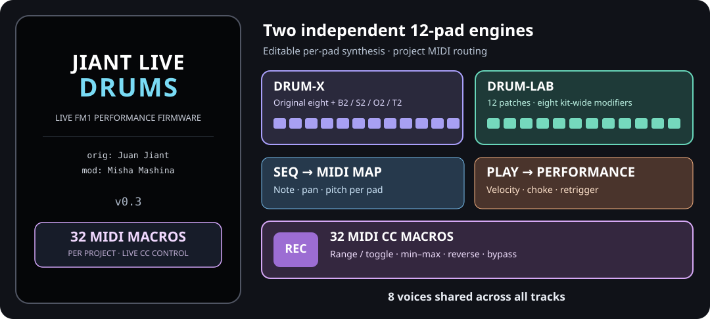

# JIANT LIVE DRUMS v0.3

**Performance-focused firmware for the M-VAVE FM1**, modified by **Misha Mashina** from **JIANT by Juan Jiant** (based on Felucca).

[](LICENSE)
[](#status-and-safety)



**[Project homepage](https://mishamashinamm.github.io/jiant-live-drums/)** · **[Emulator](https://mishamashinamm.github.io/jiant-live-drums/emu/)** · **[Drums installer](https://mishamashinamm.github.io/jiant-live-drums/webapp/installer/)** · **[Drums editor](https://mishamashinamm.github.io/jiant-live-drums/webapp/editor/)** · **[Interactive manual (inherited)](https://mishamashinamm.github.io/jiant-live-drums/manual/)**

The links above are the GitHub Pages routes for this separate Drums repository. The repository includes the Drums-specific browser emulator, firmware installer, editor, and an inherited interactive manual. The inherited manual still describes some original sequencer behavior and is **not a fully updated Drums control reference**.

JIANT LIVE DRUMS is designed for musicians using the FM1 as a **live multitimbral drum sound module**. It extends DRUM-X, adds DRUM-LAB, expands MIDI routing and CC control, and keeps the eight-voice shared pool. The **sequencer is disabled** in this edition (`FELUCCA_NO_SEQUENCER=1`); its SEQ, PLAY, and REC buttons open dedicated live-MIDI pages. Original Jiant Live remains a separate project.

> **Current status:** v0.3 milestone; experimental, **not an official Juan Jiant release**. Dedicated live-drum host tests and update-package simulations pass. **The published v0.3 firmware (`v0.3-1956d21`) was successfully installed and booted on two physical FM1 units**, and the owner reports that all tested functions work as expected. The REC macro screen's partial-redraw fix was **verified on physical hardware**: editing macro values updates the affected cells without full-screen flicker. The 32-macro REC paging and project save/load were verified in the emulator; the earlier four-macro build was also checked on the device for DRUM-LAB sound/editing, SEQ/PLAY navigation, LEDs, and external-MIDI CC macro control. These are successful owner-reported device tests, not an exhaustive hardware qualification. Back up your data and prepare a recovery method before installing. Do not use the original JIANT web installer to install Drums.

## What's different from JIANT / Jiant Live

| Feature | JIANT LIVE DRUMS v0.3 |
| --- | --- |
| MIDI input per track | Independent **RX channel 1–16** for each of six tracks. Two or more tracks may share a channel and sound together. |
| MIDI routing | **1-4**, **1-6** (assigned-channel routing), or **SEL** (selected-track routing). TRACKS 4/6 still determines how many tracks are active. |
| MIDI LEARN | **32 parameter destinations** rather than 10. One incoming CC can control several parameters on different tracks at once; MIDI Learn remains available alongside macros. |
| Project MIDI macros | Up to **32** per project, with captured MIDI CC/channel and track-engine-parameter destination; RNG/TGL behavior, editable 0–127 endpoints, reverse, and independent ON/OFF. |
| Project receive channels | The six **GLO → MIXER** RX channel assignments are saved and loaded with each project (legacy projects retain existing channels). |
| DRUM-X | **12 independent sounds** over one chromatic octave, including extra B2, S2, O2 and T2 instances with the original editing controls. |
| DRUM-LAB | **12 independent synthesized pads** with selectable sound types, ten per-pad sound parameters, three LEVELS pages, and eight kit-wide proportional controls. |
| Repurposed SEQ, PLAY and REC buttons | **SEQ** opens **DRUM MIDI MAP**, **PLAY** opens **DRUM PERFORMANCE**, and **REC** opens **MIDI CC MACROS**. The three buttons illuminate with their active live pages; none starts the removed sequencer/transport. |
| Polyphony | **Eight shared voices** across all tracks and both drum engines. |
| Display | Static **JIANT LIVE DRUMS** startup splash, default JIANT presentation, larger UI retained; decorative screen animations disabled. |
| ABOUT | JIANT LIVE DRUMS v0.3 identification and purpose, while retaining original author and license credits. |
| Browser emulator | Can load an existing JIANT **backup JSON** into an isolated session to audition saved sounds/projects without changing the physical FM1. |
| Sequencer / sound engines | **Sequencer disabled** for live use; the inherited melodic engines and effects remain. |

### Six receive channels

Each track has an independently saved RX channel. The default assignments are T1=1, T2=2, T3=3, T4=4, T5=5 and T6=6.

1. On the FM1, open **GLO → MIXER** and find the **T1–T6 RX channel** controls. Choose a MIDI channel from 1 to 16 for each track.
2. In **GLO → SYSTEM**, choose **ROUTE**:
   - **1-4:** route notes to matching tracks 1–4 (within the active TRACKS setting).
   - **1-6:** route notes to matching tracks 1–6 (within the active TRACKS setting).
   - **SEL:** incoming MIDI follows the selected track, as in JIANT.
3. Use **MENU → AUDIO → TRACKS** for 4 or 6 active tracks. RX assignments for T5 and T6 are retained even when TRACKS=4.

**Example:** assign both T1 and T2 to channel 1, choose ROUTE=1-6 with TRACKS=6, and play channel 1 from a keyboard. Both tracks receive the notes. Duplicate RX channels are intentional. Switching routing, assignments or active track count releases owned notes to avoid stuck notes.

The six RX settings are **saved with each project**. Loading a newly saved project restores its RX channels; older project files without RX data retain the current channel assignments. The original global settings remain available as the fallback for older projects.

**Project MIDI CC macros:** each project can hold up to **32** assignments (224 bytes for the rows, plus a three-byte serialized header). Active macros respond to incoming CC messages: linear range or two-value toggle, with optional reverse and independent bypass. Each row targets a saved track/engine/parameter, automatically suspending when the track uses another engine without losing its enabled setting. Multiple rows may share a CC and channel. The original 32-destination MIDI Learn remains available (active macros take priority on a matching CC). Older four-macro projects still load; projects containing more than four macros cannot be opened by earlier JLD versions without conversion. Very full projects may report `SECTION FULL` when saving additional macro data.

**REC macro editor (live build):** tap **REC** to view the macro table. Press **OCT+** to add: send a CC from your external controller (its incoming channel is captured automatically), then navigate to the desired track and sound page and turn the target parameter's knob. The macro is added with **RNG 0–127, REV OFF, ON** and the REC table reopens. **SELECT** chooses an existing row; **ALGORITHM** turns it ON/OFF; **K1** chooses RNG/TGL, **K2/K3** set the two endpoints, and **K4** toggles reverse. Turn ALGORITHM/K1/K4 clockwise for ON/TGL/REV and counterclockwise for OFF/RNG/no reverse. To delete, select a row, press **OCT−**, then **OCT+** to confirm or **OCT−** to cancel. REC cancels an unfinished assignment. The captured **CC/CH/SRC** are intentionally read-only; delete and recreate a row to change them. The ON column shows **Y** for active, **N** for disabled, and **S** when an enabled assignment is temporarily suspended by an incompatible engine. The assignment is stored with its project when saved. The original JIANT M1–M4 sound-engine macros are unchanged; the existing 32-destination MIDI Learn remains independently available.

SELECT scrolls the REC list in four-row pages. A small indicator shows the selected position and total (for example, `13/32`). The same knob and delete controls work on every row. Value edits redraw only their affected cells, avoiding whole-screen flicker on the FM1 (verified after flashing the `rec-partial-redraw` preview). The 32-row UI and persistence passed emulator testing; v0.3 flashing, boot, and expected operation were confirmed on two FM1 units. Exhaustive 32-row stress and long-duration testing on hardware remain open.

After a new assignment, REC briefly ignores residual encoder detents until the knobs settle. This prevents the knob movement used to select the destination from also changing the new macro's default RNG type or endpoints.

**Hardware testing:** On November 10, 2026, the published **JLD v0.3** firmware flashed and booted on **two FM1 devices**. Both were reported to operate as expected. The first unit's **ABOUT v0.3** display and smooth REC macro editing without full-screen redraw were explicitly checked; the second also passed the owner's functional checks. Earlier test rounds verified external MIDI macros, REC/SEQ/PLAY LEDs and pages, editing, project save/load, and emulator paging.  The isolated preview workflow and [device-test checklist](docs/macro-control-device-test.md) remain available for future development.

### MIDI LEARN: 32 destinations and shared CC

1. Open **MENU → MIDI → LEARN** and switch it **ON**.
2. Visit a track's editable parameter (for example, T1 filter cutoff) and turn its corresponding FM1 knob to select that destination.
3. Send a CC from your external MIDI controller. JIANT LIVE DRUMS learns the number for that parameter.
4. To share the same CC, select another parameter (for example, T2 resonance) and send **the same CC number** again.
5. Turn LEARN **OFF** when finished. **LEARN CLEAR** removes all learned assignments.

**Example:** CC40 → T1 cutoff **and** CC40 → T2 resonance. One movement of your controller's CC40 knob changes both simultaneously.

- A single parameter can have **one learned CC** at a time. Relearning it replaces that parameter's former assignment **without removing the same CC from other destinations**.
- The **32-entry limit counts destinations**, not distinct CC numbers. A CC assigned to five parameters uses five entries.
- System-reserved CCs and CCs already handled by the standard MIDI map cannot be learned; the firmware displays **RESERVED**. When all 32 destinations are occupied, it reports **LEARN FULL**.
- Learn assignments are **global settings**, saved persistently; settings from earlier JIANT formats are migrated.
- Normal MIDI handling (notes, sustain, pitch bend and other standard controllers) continues to work. USB-MIDI and TRS-MIDI inputs are supported.

### DRUM-X: 12 editable sounds

The original eight kit sounds remain. Four additional **independent instances** are provided:

| New sound | Duplicates the original sound type | Editing |
| --- | --- | --- |
| **B2** | BD (bass drum) | Same parameters and controls as BD; independent values |
| **S2** | SD (snare) | Same parameters and controls as SD; independent values |
| **O2** | OH (open hi-hat) | Same parameters and controls as OH; independent values |
| **T2** | TM (tom) | Same parameters and controls as TM; independent values |

DRUM-X has 12 pads but **retains the original eight drum-note assignments** (for example kick 36, snare 38 and open hat 46) rather than replacing them with a chromatic map. The four additional default notes are B2=41, S2=40, O2=43 and T2=44. All 12 notes can be reassigned individually on the **SEQ / DRUM MIDI MAP** page. Its original per-sound editing pages have not been redesigned.

### DRUM-LAB: 12 independently editable drum sounds

DRUM-LAB is a **second drum synthesis engine**, separate from DRUM-X. Each track assigned DRUM-LAB has its own kit of 12 editable pads. The default note assignments are **MIDI 36–47** (C2 through B2); the notes can be changed per pad on the SEQ page. DRUM-LAB has kick, snare, clap, closed/open hat, tom, metallic and crash sound types, including a second tom variant. You can change a pad's sound type without changing the other pads.

Open **EDIT** while a DRUM-LAB track is selected:

| EDIT pages | Controls |
| --- | --- |
| **STRIKE** (page 1) | Kit-wide **PITCH, SWEEP, BODY, SNAP** |
| **BODY** (page 2) | Kit-wide **NOISE, TONE, DRIVE, WIRES** |
| **SOUND** (page 1) | K1 chooses the pad; K2–K4 edit its **PITCH, SWEEP, BODY** |
| **SOUND 2** | K1 chooses the pad; K2–K4 edit its **SNAP, NOISE, TONE** |
| **SOUND 3** | K1 chooses the pad; K2–K4 edit its **DRIVE, WIRES, WEIGHT** |
| **SOUND 4** | K1 chooses the pad; K2 edits **METAL**, K3 changes its **TYPE**; K4 is unused |
| **LEVELS, LEVELS 2, LEVELS 3** | Independent output levels for all 12 pads |

The ten per-pad sound parameters have values **0–127**. The eight kit controls on STRIKE and BODY are a separate **0–100% multiplier layer**:

- **100%** plays the pad's own saved parameter value unchanged.
- **50%** halves its effective value *when played* (for example, pad PITCH 18 becomes 9).
- **0%** makes the effective parameter value zero across all 12 pads.

Changing a kit-wide percentage **does not overwrite individual pad settings**. All eight multipliers default to **100%** for new and migrated projects, are saved with the project, and can be assigned to incoming MIDI CCs through the existing **32-destination MIDI LEARN** mechanism. This makes them useful for shaping an entire kit live while retaining every pad's programmed sound.

### Live drum buttons: SEQ and PLAY

With the sequencer disabled, these buttons open two dedicated **per-track, per-pad** pages for **both DRUM-X and DRUM-LAB**. They do not trigger playback, recording, a pattern or a transport command.

| Button / page | What the controls do |
| --- | --- |
| **SEQ → DRUM MIDI MAP** | **ALGO** chooses the track; **SELECT** chooses a pad; **OCT− / OCT+** jump between pads 1–6 and 7–12. **K1** edits that pad's incoming MIDI note (**0–127**), **K2** its pan (**L64–R64**, C=center), and **K3** its pitch offset (**−24 to +24 semitones**). K4 is unused. |
| **PLAY → DRUM PERFORMANCE** | Same track, pad and six-pad-bank selection. **K1 CURVE** selects velocity curve **LIN, SOFT, HARD or FIX**; **K2 V>S** sets velocity-to-sound response (**0–127**); **K3 CH** assigns a choke group (**--**, G1–G4); **K4 RETR** chooses **OVR** (OVERLAP) or **RST** (RESTART). |

Six pads are visible at a time, and the selected row is highlighted. Each page uses the full screen. Press **SEQ** or **PLAY** again to close its page; pressing the other button switches directly between them. Tapping a regular page-family button (such as **EDIT** or **ENV**) or **HOME** leaves the drum page immediately. **REC** opens the project-based MIDI CC MACROS page, as described above.

On the tested FM1, these pages open with a single press and remain stable while idle. The SEQ, PLAY and REC LEDs illuminate when their live pages are active. Turning a K knob updates the affected pad row without blinking or clearing the entire screen (Stage 29C, `b9654ee`).

- **OVR / OVERLAP** is the default: a repeated hit may overlap the previous hit, subject to the eight-voice limit.
- **RST / RESTART** retriggers the selected pad instead of letting the previous hit continue.
- Pads assigned to the same **G1–G4 choke group** can cut one another; **--** means no assigned group.
- These settings belong to the selected track and pad, so different kits and pads can use different note maps, curves, choke groups and retrigger policies.

**Polyphony is eight voices total**, not eight per kit: simultaneous hits on several tracks or both drum engines compete for the same eight-voice pool. Stage 27B host stress tests passed for 12-pad and combined 24-pad bursts; a successful host test does not establish physical FM1 performance.

### Display and startup

The startup screen uses a black background with **JIANT LIVE DRUMS**, author attribution and **v0.3**. Decorative display animations and the startup LED sweep are disabled; informative UI and sound feedback remain.

## Try JIANT LIVE DRUMS on your computer

**[▶ Launch JIANT LIVE DRUMS in your browser](https://mishamashinamm.github.io/jiant-live-drums/emu/)** — once the new Pages deployment is live, no installation or FM1 hardware is required.

The browser tab is titled **JIANT LIVE DRUMS**. It includes the virtual FM1, computer-keyboard controls, MIDI CC testing, and an optional JIANT backup importer. Credits and licenses remain in the repository.

The Drums site's GitHub Actions workflow builds the emulator under `emu/` and the dedicated installer and editor under `webapp/`. Their source files are `web/emu/index.html`, `web/index_pkg.html`, and `web/editor.html`. The installer is separate from the emulator.

### Dedicated web installer, editor and documentation

The Drums site has the same core web-page options as Jiant Live:

| Page | Route | Purpose |
| --- | --- | --- |
| Home | `/` | Drums overview, links, authorship and risk notice |
| Emulator | `/emu/` | Live audition, MIDI test input, CC sender and backup importer |
| Installer | `/webapp/installer/` | USB-MIDI update, device/package validation, backup/return-to-stock and progress report |
| Editor | `/webapp/editor/` | Sound/project editing, banks, settings, complete backup/restore |
| Interactive manual | `/manual/` | Inherited JIANT navigation and control reference (Drums differences noted) |

The site generator (`web/make_site.py`) embeds the tested update libraries and packages only the Drums build passed to it. The GitHub Pages workflow builds both hardware firmware and emulator with `FELUCCA_NO_SEQUENCER=1` from the current `main` commit; it does not select older JIANT `STABLE`, `PREVIEW`, or `CLASSIC` builds. Publish the site only after its workflow succeeds and the displayed version and SHA-256 are verified.

### Run the emulator locally

You can also build and serve the emulator on your own computer.

Requirements: this source checkout, the original build dependencies, Python 3, and **Emscripten** (`emcc`) for WebAssembly builds.

```sh
FELUCCA_NO_SEQUENCER=1 bash build.sh
FELUCCA_NO_SEQUENCER=1 bash web/emu/build.sh
python3 -m http.server 8000 --directory build/emu
```

Open **http://localhost:8000/** in a desktop browser and click **Switch on**. The computer keyboard and on-screen controls can play it. The page also has a **MIDI test input** panel for selecting channels 1–16 and auditioning 12 DRUM-X notes.

### Audition an existing JIANT backup

Before clicking **Switch on**:

1. Use the **Jiant backup (.json)** picker above the emulator to select a backup made with the JIANT backup tool.
2. Click **Switch on**. The file is validated and its saved objects are loaded into an **isolated browser session**.
3. Open your sounds, user banks and projects in the emulator and verify them by ear and by their parameter settings.

The original backup file and the FM1 are not changed. An imported backup is **not silently written over an existing browser flash session**. The restore path has been verified with a real JIANT v0.9.17 backup, including user banks and a project, but **this does not yet prove hardware flashing or every backup version is compatible**.

The Drums emulator does not load a sample bank or offer sample-kit playback. It retains the hardware controls, backup import, and MIDI test tools.

## Status and safety

- **v0.3 release:** [GitHub Actions build and deployment](https://github.com/MishaMashinaMM/jiant-live-drums/actions/runs/42855710544) completed successfully; the [public installer](https://mishamashinamm.github.io/jiant-live-drums/webapp/installer/) serves `v0.3-1956d21`. Both physical FM1 units were flashed and checked successfully on November 10, 2026.
- **Host regression:** the live-drum host regression suite covers drum engines, MIDI routing, project serialization, macro control, and Stage 27B stress. The `macro-32` firmware and emulator build jobs, including all 11 live-drum host regression suites, passed on November 10, 2026.
- **32-macro build:** source commit [`5c79b3b`](https://github.com/MishaMashinaMM/jiant-live-drums/commit/5c79b3b7b394c9d2a6ac75d4847aef9ef81e44da) produced the [successful firmware and emulator preview artifacts](https://github.com/MishaMashinaMM/jiant-live-drums/actions/runs/42836474817), including the installer used for the latest device flash. The earlier Stage 29C package `felucca-v0.2-b9654ee.fwsc` is historical, not the current release.
- **REC partial redraw:** the [firmware and emulator CI run](https://github.com/MishaMashinaMM/jiant-live-drums/actions/runs/42849592862) passed all 11 live-drum host regression suites. The new installer was successfully flashed to an FM1 on November 10, 2026; K-knob macro edits no longer cause full-screen flickering on the device.
- **Update simulation:** Stage 29C OTA staging, CRC validation, allowed flash boundaries and the Stage 29B → 29C loader update passed host tests. These checks do **not** guarantee recovery from a failed physical update.
- **Physical FM1 testing (November 9–10, 2026):** **v0.3 (`1956d21`) was successfully flashed and booted on two FM1 units**, and the owner reported **all performed device checks passed**. The first device confirmed ABOUT v0.3 and smooth REC partial updates without flicker; the second also functioned as expected. Earlier physical tests confirmed DRUM-LAB sound/editing, SEQ/PLAY navigation, LEDs, and external-controller MIDI CC macros. Emulator tests exercised ten macros over three pages, editing, deletion, and save/reload; host tests exercised all 32. Long-duration reliability and exhaustive physical stress testing remain open.
- **Safety:** user projects/sound banks/settings were backed up externally before installation. A fully verified physical recovery procedure is still needed. The dedicated GitHub Pages installer is deployed, but availability does not imply that every device or upgrade path is tested.

For regression testing in the development environment:

```sh
bash tests/run_live_drum_tests.sh
```

## Upstream documentation and references

JIANT LIVE DRUMS retains many JIANT synthesis engines, interfaces, effects and editing workflows, but removes the sequencer and substantially changes drum pages. For unchanged controls, refer to the original manual:

- [Original JIANT project](https://github.com/juanjiant-bit/JIANT) and [original README](https://github.com/juanjiant-bit/JIANT/blob/main/README.md)
- [JIANT English manual](https://github.com/juanjiant-bit/JIANT/blob/main/docs/MANUAL.md) and [Spanish manual](https://github.com/juanjiant-bit/JIANT/blob/main/docs/MANUAL.es.md)
- [Upstream interactive manual](https://juanjiant-bit.github.io/JIANT/manual/)
- [Felucca](https://github.com/hugelton/Felucca), the firmware on which JIANT is based
- [SLOOP](https://github.com/isod89/sloop-fm1), source of JIANT's song-system lineage

**Important:** the inherited manual, navigation map, screenshots and cheat sheets describe upstream JIANT revisions; they are **not exact Jiant Live Drums v0.2 control maps**. Original illustrations under [`docs/`](docs/) are historical upstream assets.

## Authors, credits and license

- **Original JIANT firmware:** Juan Ignacio Antonucci (**Juan Jiant**).
- **JIANT LIVE DRUMS modification:** **Misha Mashina**.
- **Felucca firmware:** Hügelton Instruments, including Leo Kuroshita and other credited contributors.
- Additional contributors, predecessor projects, third-party tools, and font licenses retain their original attribution in source headers and accompanying license files.

**License: [GNU General Public License v3.0 only](LICENSE) (GPL-3.0-only).** This fork remains free software under the original copyleft license; modifications are identified as such. Original authors' credits and rights are preserved.

For the original author's project and support options, see [JIANT](https://github.com/juanjiant-bit/JIANT).
