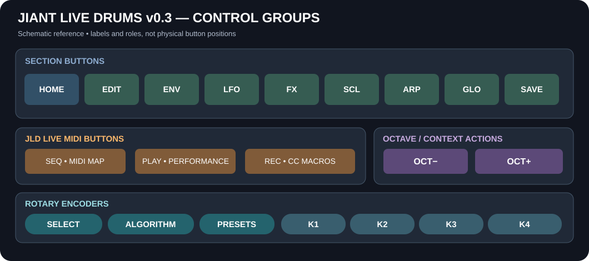
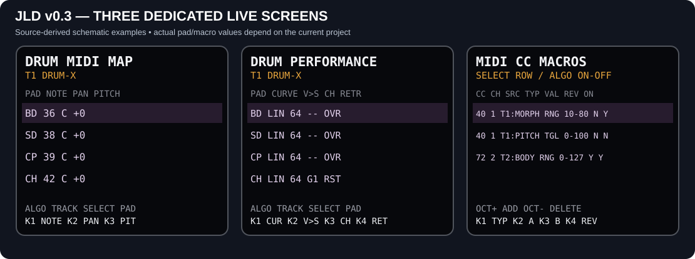

# JIANT LIVE DRUMS v0.3 — User Manual (draft)

This guide describes **JIANT LIVE DRUMS (JLD) v0.3**, the FM1 live-performance firmware derived from JIANT. It covers the controls in the **sequencer-disabled Drums build**, not the original JIANT sequencer. The source of truth is the firmware implementation; any annotated schematic is explicitly marked as such.

> **Safety:** Back up projects and sound banks before installing another firmware. JLD v0.3 was successfully flashed onto two FM1 units, one from official V15 and another from original JIANT. Other migration paths and recovery after a failed flash are not established by those tests.

## 1. Physical controls and navigation

### 1.1 Buttons and rotary controls

| Control | Ordinary operation | Important context |
| --- | --- | --- |
| **HOME** | Open HOME; a repeat tap moves to its next group | **Hold HOME** to open or close MENU; a tap also closes MENU. |
| **EDIT** | Sound-engine editing | Pages differ for synthesizers, FM6, DRUM-X and DRUM-LAB. |
| **ENV** | Envelopes, destination and stage pages | May expose track and individual envelope views. |
| **LFO** | Modulation matrix, LFO and MSEQ | The original engine M1–M4 macros are separate from JLD REC macros. |
| **FX** | Track sends/effects and global buses | Delay, reverb, chorus, slicer and master/punch groups follow. |
| **SCL** | Scale and chord controls | Works on the selected track. |
| **ARP** | Arpeggiator controls | ARP and ARP 2 pages. |
| **GLO** | Mixer, sends, global and system pages | The normal entry page is MIXER; other LIVE pages exist in the source. |
| **SAVE** | Preset, project and tool pages | Store edited settings explicitly when you want to keep them. |
| **SEQ** | **DRUM MIDI MAP** | Does not start the original sequencer. |
| **PLAY** | **DRUM PERFORMANCE** | Does not start the original transport. |
| **REC** | **MIDI CC MACROS** | Creates/edits up to 32 project macros; does not record a sequence. |
| **OCT− / OCT+** | Lower/raise the playing octave | Both together reset the offset; the live screens repurpose them. |
| **SELECT** | Move between visible pages | On SEQ/PLAY chooses a pad; on REC chooses a macro. |
| **ALGORITHM** | Change active track | On REC it instead turns the highlighted macro off/on. |
| **PRESETS** | Browse presets | Not a parameter knob. |
| **K1–K4** | Edit displayed parameters | Some columns may be unused or have special selection functions. |

The normal octave offset is **−3 to +3**. Changing a parameter typically acts immediately, but project-specific changes are only retained across loading/reboot once the project is saved.

### 1.2 Moving between pages

1. Press a section button (for example, **EDIT**). It opens the last page remembered for that section.
2. Turn **SELECT** to move through available pages, one page per detent. It stops at the ends rather than wrapping.
3. Press the same section button again to jump to the next **group** of pages in that section.
4. Turn **K1–K4** to edit the controls shown on the page. If a control is dimmed or absent, it may not apply to the selected engine.
5. Turn **ALGORITHM** to move between the active tracks (normally four, optionally six).

Navigation is **context-dependent**: choosing a different engine changes EDIT's page list; the REC/SEQ/PLAY live pages intercept SELECT, ALGORITHM and K1–K4 for their own tables.

### 1.3 Hold combinations and layers

| Gesture | Behavior |
| --- | --- |
| **Hold HOME** | Open/close settings MENU. |
| **Hold GLO + turn SELECT** | Adjust tempo (BPM). |
| **Hold ENV, SCL, ARP or SAVE + turn SELECT** | Jump into that section and move through its pages. |
| **Hold EDIT, LFO or FX + turn SELECT** | A *dice/randomize* action for the corresponding sound/modulation/effects, rather than ordinary page navigation. Treat as a potentially audible edit. |
| **Hold HOME + turn SELECT** | Access HOME's generator pages. |
| **Hold a section button + turn PRESETS** | No ordinary page navigation; this combination is intentionally suppressed. |
| **OCT− + OCT+** | Reset ordinary keyboard octave offset to zero; this is not the meaning of OCT buttons in every editor. |

**Performance layers:** Some held buttons expose a second control layer using the keys and knobs. These are distinct from ordinary button taps. The exact performance-layer assignments are context-sensitive; use the on-screen layer labels. In particular, do not confuse the original **M1–M4** engine macros with the REC MIDI CC macros.

### 1.4 Settings MENU

Hold **HOME**. MENU has six visible physical pages, each with K1–K4 controls:

| Page | K1 | K2 | K3 | K4 |
| --- | --- | --- | --- | --- |
| **SCREEN** | Scope | Screen sleep | LED glow | Scale LEDs |
| **AUDIO** | Speaker EQ | Tracks 4/6 | Load | BPM lock |
| **CLICK** | Click | Click level | Count-in | MIDI out |
| **MIDI/USB** | MIDI Learn | Learn clear | USB audio mode | USB level |
| **CONTROLS** | Hold time | Knob speedup | FX latch | Panel calibration |
| **SYSTEM** | Restore last | CPU cores | CPU clock | About |

Turn **SELECT** to change the MENU page; **ALGORITHM** changes its higher-level tab. Turn the relevant **K** knob to change a value. Some action entries require **OCT+** after selection; in particular, **LEARN CLEAR** is destructive to the stored learn mappings. HOME exits MENU.

> Older JIANT screenshots may show other MENU arrangements. The table above comes from JLD's six-page layout.

## 2. Tracks, GLO and MIDI routing

In **GLO → MIXER**, choose per-track levels, stereo positioning, effects and the six **MIDI RX channels**. RX channels are in the range **1–16** and are allowed to repeat. Tracks 5 and 6 can retain assignments while inactive. The current project stores these settings when saved.

Under **GLO → SYSTEM**, set **ROUTE**:

| ROUTE | Meaning |
| --- | --- |
| **1-4** | Matching assigned input channels route to active tracks 1–4. |
| **1-6** | Matching assigned input channels route to active tracks 1–6. |
| **SEL** | Incoming MIDI follows the selected track. |

The separate **TRACKS 4/6** setting controls how many tracks are active. For example, to layer two synthesizers from one keyboard, assign tracks 1 and 2 the same RX channel and select assigned-channel routing. Note ownership follows the sounding tracks, even if you later change the selected track.

## 3. JLD live drum screens

### 3.1 SEQ — Drum MIDI Map

Press **SEQ**. **ALGORITHM** changes track, **SELECT** selects one of 12 pads, and **OCT−/OCT+** choose the lower/upper six-pad bank. Press SEQ again to close.

| Knob | Setting | Range |
| --- | --- | --- |
| **K1** | Incoming MIDI note for the selected pad | 0–127 |
| **K2** | Pad pan | L64 through center to R64 |
| **K3** | Pad pitch offset | −24 to +24 semitones |
| **K4** | Unused | — |

### 3.2 PLAY — Drum Performance

Press **PLAY**. Track, pad and bank selection work as on SEQ. Press PLAY again to close.

| Knob | Setting | Values |
| --- | --- | --- |
| **K1** | Velocity curve | LIN / SOFT / HARD / FIX |
| **K2** | Velocity-to-sound response | 0–127 |
| **K3** | Choke group | None / G1 / G2 / G3 / G4 |
| **K4** | Retrigger policy | OVR (overlap) / RST (restart) |

Both drum engines share **eight simultaneous synthesis voices total**. OVR may let a repeated hit overlap; RST restarts its pad. Pads in the same assigned choke group can cut one another.

### 3.3 REC — Project MIDI CC Macros

Press **REC** to open the table. Up to **32 mappings per project** can connect external MIDI controller messages to track parameters. Each mapping captures a **CC number**, **MIDI channel** and an immutable **track/engine/parameter destination**.

| Control | Action |
| --- | --- |
| **OCT+** | Add: send a CC from the controller, navigate to a sound parameter and turn its knob to choose the destination. |
| **SELECT** | Highlight a macro; the list scrolls in four-row pages. |
| **ALGORITHM** | Turn highlighted mapping ON/OFF (clockwise ON, counterclockwise OFF). |
| **K1** | Choose RNG or TGL (counterclockwise RNG, clockwise TGL). |
| **K2 / K3** | Set the two endpoint values, each 0–127. |
| **K4** | Reverse OFF/ON (counterclockwise OFF, clockwise ON). |
| **OCT−** | Ask to delete; **OCT+** confirms, **OCT−** cancels. |

**RNG** scales the incoming CC continuously between the two endpoints. They may be entered in descending order (for example, 100→50). **TGL** selects between precisely those two values. **REV** reverses the input direction. Multiple rows may respond to the same CC/channel.

The ON column shows **Y** (active), **N** (disabled) or **S** (suspended because the target track no longer uses the engine that owns the parameter). Suspended mappings are retained and reactivate when the matching engine returns. A mapping's CC, channel and destination cannot be edited: delete and recreate it instead. **Save the project** to retain additions, edits and deletions across project reloads.

The older **MIDI Learn** feature remains available independently, with 32 global destination slots. Its assignments are stored as global settings, **not** as REC project macros.

## 4. DRUM-X

DRUM-X provides **12 independently editable sounds**. The four additional pads B2, S2, O2 and T2 duplicate the sound-generation options of BD, SD, OH and TM respectively, but have their **own settings**. The original eight sounds and their MIDI note assignments remain available.

| Pad | Default MIDI note |
| --- | ---: |
| BD | 36 |
| SD | 38 |
| CP | 39 |
| CH | 42 |
| OH | 46 |
| TM | 45 |
| RM | 37 |
| BL | 56 |
| B2 | 41 |
| S2 | 40 |
| O2 | 43 |
| T2 | 44 |

Open **EDIT** on a DRUM-X track to find its KIT, SOUND, LEVELS and TONE groups. The SOUND pages retain the original per-sound editing logic; K1 selects the sound, while the remaining knobs adjust that page's displayed parameters. LEVELS, LEVELS 2 and LEVELS 3 cover all 12 pads. Change each pad's MIDI note independently using **SEQ**.

## 5. DRUM-LAB

DRUM-LAB provides **12 pads**, initially mapped to MIDI notes **36–47**, with independently editable synthesis and sound types. Select its track and open EDIT:

| Group/page | Controls |
| --- | --- |
| **STRIKE** | Kit-wide PITCH, SWEEP, BODY, SNAP |
| **BODY** | Kit-wide NOISE, TONE, DRIVE, WIRES |
| **SOUND** | Pad selection; PITCH, SWEEP, BODY |
| **SOUND 2** | Pad selection; SNAP, NOISE, TONE |
| **SOUND 3** | Pad selection; DRIVE, WIRES, WEIGHT |
| **SOUND 4** | Pad selection; METAL, sound TYPE; K4 unused |
| **LEVELS 1–3** | Levels for 12 pads |

The ten per-pad sound parameters run **0–127**. The eight kit-wide STRIKE/BODY multipliers run **0–100%** and act on effective playback values without overwriting each pad's stored parameters. 100% leaves a pad unchanged; 50% halves the affected value; 0% reduces it to zero. They are saved with the project.

## 6. Saving, loading and backups

Use **SAVE** to access user presets and project operations. A saved project preserves its eligible track settings, RX channel assignments and REC macro rows; edits made after a save are not a replacement for saving again. A deletion that has not been saved can reappear when the previous project is loaded.

The [JLD web editor](https://mishamashinamm.github.io/jiant-live-drums/webapp/editor/) offers device backup and restore. **Make a full backup before flashing**; do not confuse exporting a sound preset with backing up all device data. The [dedicated installer](https://mishamashinamm.github.io/jiant-live-drums/webapp/installer/) is separate from the editor.

## 7. Useful live setups

**Two layered voices:** set T1 and T2 to the same RX channel, then select ROUTE 1-4 or 1-6 and adjust their pan and levels individually. One keyboard can play both.

**A single foot controller shaping several sounds:** create multiple REC rows that share the same CC and channel but target different parameters, then assign different RNG/TGL values to each. Individual rows can be bypassed without deletion.

**12-pad drum kit from an external controller:** choose DRUM-X or DRUM-LAB on the desired track, set its RX channel in GLO, then customize note/pan/pitch per pad in SEQ and its velocity/choke/retrigger response in PLAY.

## 8. Scope and verification

This draft is based on the current JLD input/navigation code, the code-backed v0.3 feature descriptions and existing interface illustrations. **Inherited screenshots are illustrations, not proof of pixel-identical current v0.3 layouts**. No screenshot of REC, SEQ or PLAY is presented here as a captured physical display; their exact controls are documented from the dedicated source paths. The initial two-unit v0.3 flashing tests and REC partial-redraw behavior were confirmed by the device owner; exhaustive long-duration hardware stress testing has not been reported.

Original project and firmware authorship, licenses and upstream credits remain in the repository README and license files.
